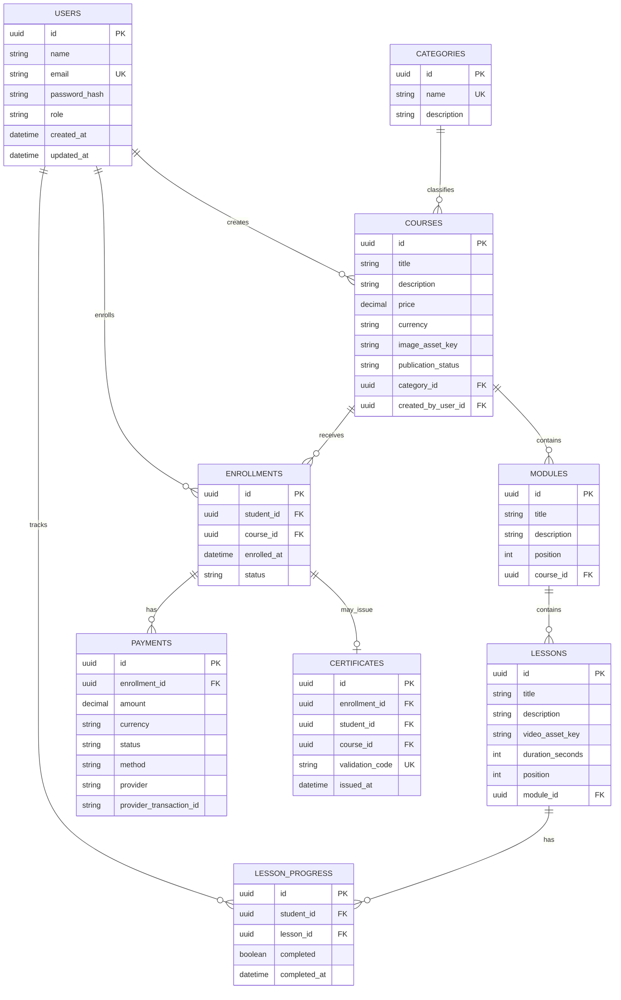

# Modelagem inicial do banco de dados

Este documento descreve o modelo relacional inicial da plataforma. É uma especificação conceitual: não escolhe um banco, não define migrations e não configura autenticação nem pagamentos.

## Convenções

- Cada entidade tem `id UUID` como chave primária, obrigatório.
- Campos marcados como **obrigatórios** devem ser `NOT NULL`; os demais podem ser nulos conforme indicado.
- Valores monetários usam decimal exato (`DECIMAL(12,2)`), nunca ponto flutuante. `currency` usa um código ISO 4217 de três letras.
- Datas são armazenadas com fuso horário. `created_at` e `updated_at` representam instantes UTC; a aplicação os apresenta no fuso do usuário.
- Chaves estrangeiras são obrigatórias, salvo indicação contrária. Registros referenciados por matrículas, pagamentos ou certificados não devem ser apagados fisicamente; prefira arquivamento e retenção definida.
- `UNIQUE` indica uma restrição de unicidade. Restrições condicionais, como unicidade apenas quando um valor não é nulo, deverão ser implementadas conforme o banco escolhido.

## Diagrama ER

## Entidades e restrições

### Usuários (`users`)

| Campo | Obrigatoriedade e regra |
|---|---|
| `id` | Obrigatório; PK UUID. |
| `name` | Obrigatório. |
| `email` | Obrigatório; único após normalização (remover espaços e comparar sem diferenciar maiúsculas/minúsculas). |
| `password_hash` | Obrigatório; contém somente o resultado de um hash adaptativo de senha, nunca a senha original. |
| `role` | Obrigatório; somente `student` ou `admin`. |
| `created_at`, `updated_at` | Obrigatórios; criação e última atualização. `created_at` recebe o instante atual por padrão. |

Um usuário pode ser o criador de vários cursos e pode ter várias matrículas e registros de progresso. O papel é validado no servidor: o cadastro público não pode escolher `admin` nem promover a própria conta.

### Categorias (`categories`)

| Campo | Obrigatoriedade e regra |
|---|---|
| `id` | Obrigatório; PK UUID. |
| `name` | Obrigatório; único após normalização sem diferenciar maiúsculas/minúsculas. |
| `description` | Opcional. |

Uma categoria classifica zero ou vários cursos; cada curso pertence a uma categoria. Se futuramente um curso puder pertencer a várias categorias, será necessária uma tabela de associação.

### Cursos (`courses`)

| Campo | Obrigatoriedade e regra |
|---|---|
| `id` | Obrigatório; PK UUID. |
| `title`, `description` | Obrigatórios. |
| `price` | Obrigatório; decimal maior ou igual a zero. Zero representa um curso gratuito. |
| `currency` | Obrigatório; código ISO 4217. |
| `image_asset_key` | Opcional; referência à imagem em armazenamento de arquivos, não os bytes da imagem. |
| `category_id` | Obrigatório; FK para `categories.id`. |
| `publication_status` | Obrigatório; `draft`, `published` ou `archived`; padrão `draft`. |
| `created_by_user_id` | Obrigatório; FK para `users.id`, identificando o administrador criador. |
| `created_at`, `updated_at` | Obrigatórios; datas de auditoria. |

Administradores podem criar cursos; a aplicação deve verificar o papel antes de criar ou alterar um curso. O valor de `created_by_user_id` vem da identidade autenticada, não de um campo livre enviado pelo cliente. Só cursos publicados ficam disponíveis para matrícula. A política para edição de cursos criados por outro administrador fica pendente.

### Módulos (`modules`)

| Campo | Obrigatoriedade e regra |
|---|---|
| `id` | Obrigatório; PK UUID. |
| `course_id` | Obrigatório; FK para `courses.id`. |
| `title` | Obrigatório. |
| `description` | Opcional. |
| `position` | Obrigatório; inteiro maior que zero, ordena módulos dentro do curso. |

Um curso contém zero ou vários módulos. Aplicar `UNIQUE(course_id, position)` para impedir posições repetidas no mesmo curso.

### Aulas (`lessons`)

| Campo | Obrigatoriedade e regra |
|---|---|
| `id` | Obrigatório; PK UUID. |
| `module_id` | Obrigatório; FK para `modules.id`. |
| `title` | Obrigatório. |
| `description` | Opcional. |
| `video_asset_key` | Opcional enquanto o conteúdo está em rascunho; obrigatório antes da publicação da aula. Referencia o armazenamento de vídeo. |
| `duration_seconds` | Opcional enquanto o vídeo não foi processado; quando preenchido, inteiro maior que zero e obrigatório para publicar a aula. |
| `position` | Obrigatório; inteiro maior que zero, ordena aulas dentro do módulo. |

Um módulo contém zero ou várias aulas. Aplicar `UNIQUE(module_id, position)`. A aplicação deve validar a regra de vídeo e duração no momento da publicação.

### Matrículas (`enrollments`)

| Campo | Obrigatoriedade e regra |
|---|---|
| `id` | Obrigatório; PK UUID. |
| `student_id` | Obrigatório; FK para `users.id`, cujo papel deve ser `student`. |
| `course_id` | Obrigatório; FK para `courses.id`. |
| `enrolled_at` | Obrigatório; padrão para o instante da matrícula. |
| `status` | Obrigatório; inicialmente `pending`, `active`, `completed`, `canceled` ou `suspended`. |

Aplicar `UNIQUE(student_id, course_id)`: o mesmo aluno não pode ter duas matrículas para o mesmo curso. Também declarar `UNIQUE(id, student_id, course_id)` para servir de alvo à FK composta de `certificates` e garantir que aluno e curso do certificado pertençam àquela matrícula. Cada matrícula liga um aluno a um curso; cada aluno e curso podem ter várias matrículas. Matrículas gratuitas podem ser ativadas sem pagamento. A concessão de acesso para cursos pagos depende da confirmação do provedor e deve ser feita de forma idempotente.

### Progresso das aulas (`lesson_progress`)

| Campo | Obrigatoriedade e regra |
|---|---|
| `id` | Obrigatório; PK UUID. |
| `student_id` | Obrigatório; FK para `users.id`, cujo papel deve ser `student`. |
| `lesson_id` | Obrigatório; FK para `lessons.id`. |
| `completed` | Obrigatório; booleano, padrão `false`. |
| `completed_at` | Opcional; instante da conclusão. |

Aplicar `UNIQUE(student_id, lesson_id)` para permitir no máximo um registro de progresso do aluno por aula. Exigir `completed_at` quando `completed = true` e mantê-lo nulo quando `completed = false`. A ausência de linha representa uma aula ainda não iniciada. Antes de criar ou atualizar progresso, o servidor valida que o aluno tem matrícula ativa no curso ao qual a aula pertence; o aluno só pode alterar o próprio progresso.

### Pagamentos (`payments`)

| Campo | Obrigatoriedade e regra |
|---|---|
| `id` | Obrigatório; PK UUID. |
| `enrollment_id` | Obrigatório; FK para `enrollments.id`. |
| `amount` | Obrigatório; valor decimal maior que zero. |
| `currency` | Obrigatório; código ISO 4217. |
| `status` | Obrigatório; `pending`, `paid`, `failed`, `canceled` ou `refunded`. |
| `method` | Obrigatório; método informado pelo provedor, por exemplo cartão ou Pix. |
| `provider` | Obrigatório; identificador do provedor de pagamento. |
| `provider_transaction_id` | Opcional enquanto não houver transação criada no provedor; único em conjunto com `provider` quando preenchido. |
| `created_at`, `updated_at` | Obrigatórios; datas de auditoria. |

Uma matrícula pode ter zero ou vários pagamentos, permitindo registrar tentativas distintas. A chave de unicidade da transação evita processar duas vezes o mesmo evento do provedor; a confirmação deve ser idempotente. O valor e a moeda do pagamento registram o que foi cobrado, mesmo que o preço atual do curso mude.

### Certificados (`certificates`)

| Campo | Obrigatoriedade e regra |
|---|---|
| `id` | Obrigatório; PK UUID. |
| `enrollment_id` | Obrigatório; FK para a matrícula; único, no máximo um certificado por matrícula. |
| `student_id`, `course_id` | Obrigatórios; identificam aluno e curso da matrícula. A FK composta `(enrollment_id, student_id, course_id)` deve apontar para a mesma matrícula. |
| `validation_code` | Obrigatório; único, não previsível e difícil de adivinhar. |
| `issued_at` | Obrigatório; instante de emissão. |

Uma matrícula pode gerar zero ou um certificado. Aplicar `UNIQUE(validation_code)` e `UNIQUE(enrollment_id)`. A emissão exige matrícula concluída e aprovação nos critérios de conclusão do curso, ainda a definir.

## Relacionamentos e garantias

- `users` 1:N `courses` como criador; `categories` 1:N `courses`; `courses` 1:N `modules`; `modules` 1:N `lessons`.
- `users` N:N `courses` por meio de `enrollments`; a restrição única aluno/curso elimina duplicidade.
- `users` N:N `lessons` por meio de `lesson_progress`; a restrição única aluno/aula mantém um único estado por aula.
- `enrollments` 1:N `payments`; `enrollments` 1:0..1 `certificates`.
- Chaves estrangeiras asseguram a existência dos registros relacionados. Papel do usuário, matrícula ativa, correspondência entre aula e curso e transições de status exigem validação no servidor, de preferência na mesma transação da escrita. Podem ser reforçados com restrições ou gatilhos após escolher o banco.

## Segurança e controle de acesso

- Armazenar senhas somente com hash adaptativo apropriado (por exemplo, Argon2id ou bcrypt), usando uma biblioteca mantida; nunca registrar senha em texto simples ou reversível.
- Validar autorização no servidor em cada operação. Alunos leem apenas seus dados de matrícula, progresso e certificados; identificadores de aluno devem vir da sessão autenticada. Administradores gerenciam o catálogo conforme a política de administração.
- Tornar listagem de cursos publicados pública, se esse for o requisito do produto; rascunhos e operações de gestão são restritos a administradores.
- Guardar imagens e vídeos em armazenamento de objetos e persistir apenas suas chaves. Entregar conteúdo privado com URLs temporárias ou autorização equivalente.
- Não persistir número completo de cartão, código de segurança, credenciais do provedor ou segredos em `payments`. Guardar segredos fora do banco e limitar dados pessoais nos logs.
- Restringir permissões da conta usada pela aplicação ao necessário, proteger conexões e backups e definir retenção e exclusão de dados pessoais conforme a política do produto.

## Decisões tomadas e pontos a resolver

### Decisões desta etapa

- Um usuário tem exatamente um papel (`student` ou `admin`); identidade e autorização ficam centralizadas em `users`.
- Cada curso pertence a uma categoria e tem um administrador criador.
- Posições de módulos e aulas são numeradas a partir de 1 e únicas dentro do respectivo pai.
- Matrícula é única por aluno/curso; progresso é único por aluno/aula; certificado é único por matrícula e seu código é globalmente único.
- Tentativas de pagamento são preservadas separadamente, e preço/moeda cobrados ficam no pagamento.
- Arquivos de mídia ficam fora do banco; o modelo persiste referências aos arquivos.

### Dúvidas para próximas etapas

1. Qual banco relacional será adotado e como implementará unicidade sem diferenciar maiúsculas/minúsculas, UUIDs, timestamps e unicidade condicional do identificador de transação?
2. Quais moedas, provedores e métodos de pagamento serão aceitos? Haverá parcelamento, estorno parcial ou múltiplas cobranças por matrícula?
3. Cursos gratuitos ficam imediatamente ativos? Qual é a regra para acesso durante pagamento pendente, falha, estorno ou cancelamento?
4. A matrícula guarda um retrato do preço do curso no momento da compra, além do valor registrado em `payments`?
5. Um certificado é emitido ao concluir todas as aulas ou há avaliações e critérios adicionais? Como revogar ou reemitir certificados?
6. Cursos podem ter múltiplas categorias? Administradores podem editar cursos criados por outros administradores?
7. Quais são as regras de armazenamento, processamento, acesso e expiração para vídeo e imagem? Aula sem vídeo pode existir como rascunho?
8. Como tratar exclusão de contas, retenção de registros financeiros, histórico de auditoria e pedidos de remoção de dados?
9. Quais status e transições serão permitidos para curso, matrícula e pagamento, e quem pode executá-los?
